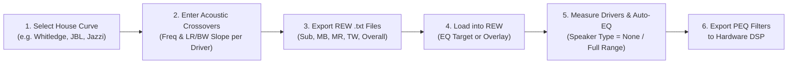

# Jazzi's Tuning Companion: Online Research, Usage Guide & Requirements Cross-Check

This document compiles online research from car audio enthusiast and sound engineering communities (**DIYMobileAudio (DIYMA)**, **CarAudioJunkies (CAJ)**, **AV Nirvana / Room EQ Wizard**, **Audiofrog**, and web adaptations like **Nono Tuning Tool** and **TuneLab**) on how **Jazzi's Tuning Companion** (and its community-maintained successor, the **JEB Tuning Companion**) is used in practice.

It is structured to serve as the master reference and input specification for the conversion agents.

---

## 1. History & Evolution of the Tool

1. **Origins (`v5.7` and earlier)**: Created by **Justin Zazzi** ("Jazzi" / *Wave Shepherd*) on DIYMA as *Jazzi's Tuning Companion for REW*. It was built to solve a critical gap in car audio DSP tuning: REW's built-in target curve settings only allow a simple bass-tilt or high-frequency droop, whereas car audio tuners use complex empirical house curves (like Whitledge or Audiofrog/Harman) combined with multi-way acoustic crossovers.
2. **Expansion (`v8.2` and `JEB V7.10`)**: Maintained and expanded by community contributors including **Erica (@AudioGal)** and **@Uberverbosity** under the name **JEB Tuning Companion**. They unified the 2-way and 3-way tabs into a configurable 5-channel system matrix (`Sub2`, `Sub1`, `Midbass`, `Midrange`, `Tweeter`), added Global Offset scaling, and expanded the export macro to support **SMAART** (with 1/3, 1/6, 1/12, 1/24, 1/48 octave banding and Magnitude/RTA formats), **Audiotec Fischer (ATF / Helix DSP PC-Tool)**, and **Dirac Live**.

---

## 2. Complete Capabilities Inventory (From Online Guides)

Across all versions of the companion, the tool provides **four core modules**:

### Module A: Target Curves & Acoustic Crossover Generator (Primary Module)
- **House Curve Selection**: Lets the user select from industry-standard car audio house curves or define custom curves:
  - **Whitledge**: Pronounced, smooth low-end bass rise (+24 dB at 20 Hz tapering through midbass) with a gentle high-frequency roll-off (-10 dB at 20 kHz) to combat vehicle cabin reflections and road noise masking.
  - **Half-Whitledge (`.5 Whitledge`)**: Exactly half the amplitude of the Whitledge curve (+12 dB at 20 Hz to -5 dB at 20 kHz) for a milder, more neutral tonal balance.
  - **JBL / Audiofrog (Andy Wehmeyer)**: Based on Harman/Audiofrog research; features a controlled ~9 dB bass shelf and smooth ~0.5–1 dB/octave downward tilt above 1 kHz.
  - **Jazzi / Jazzi v2**: Justin Zazzi's personal hybrid curves blending a punchy sub/midbass shelf with a smooth treble taper.
  - **EPY**: Community-popularized curve with a strong sub-bass shelf and tailored midrange transition.
  - **ATF**: Audiotec Fischer (Helix/Brax/Match) reference target profile.
  - **Flat**: 0 dB across all frequencies (useful for checking pure crossover slopes or home/studio monitors).
  - **Custom (Custom 1, Custom 2, Custom 3)**: User-editable 31-band ISO 1/3-octave tables.
- **Channel & System Selection**:
  - Supports 2-way + Sub, 3-way + Sub, or 4-way + Dual Sub (`Sub2` for rear/trunk sub, `Sub1` for front/mid-sub, `Midbass`, `Midrange`, `Tweeter`).
- **Acoustic Crossover Integration**:
  - User enters the **High-Pass (HP)** and **Low-Pass (LP)** cutoff frequencies (in Hz) and selects the **Filter Topology & Slope** for each active driver:
    - **Linkwitz-Riley (LR)**: `12 dB/octave` (LR2), `24 dB/octave` (LR4 — the overwhelming favorite in car audio because adjacent drivers are in-phase at the crossover frequency and sum flat at -6 dB each), and `48 dB/octave` (LR8).
    - **Butterworth (BW)**: `12 dB/octave` (BW2), `24 dB/octave` (BW4), `36 dB/octave` (BW6), and `48 dB/octave` (BW8).
  - **Validation / Warnings**: Alerts the user if adjacent driver crossover frequencies or filter types do not match (though advanced users sometimes intentionally stagger electrical/acoustic targets, Known as underlapping/overlapping).
  - **Global Offset**: Allows shifting the entire target curve up or down in dB (e.g., to match a 75 dB or 80 dB measurement baseline in REW or Smaart).
- **Multi-Platform Export**:
  - Exports individual driver target curves (`Sub`, `Midbass`, `Midrange`, `Tweeter`) **and** the `Overall` composite house curve into text files formatted for:
    - **REW (Room EQ Wizard)**: 2-column tab/space-separated `<Frequency> <dB>` text files.
    - **SMAART**: Includes Smaart ASCII header metadata (`Line`, `Color`, `Show`, `Band`) and supports both RTA fractional-octave banding (`1/3`, `1/6`, `1/12`, `1/24`, `1/48` octave) and Transfer Function Magnitude (`Mag`) traces.
    - **Helix / ATF (DSP PC-Tool)**: Formatted for importing into Audiotec Fischer's RTA/TuneEQ reference target system.
    - **Dirac Live**: Formatted with Dirac breakpoint syntax.

---

### Module B: Safe Crossover Frequency & Excursion Calculator
- **How it is used**: Before picking crossover frequencies in Module A, users open the **Crossover Frequency** tab to determine how low a speaker (subwoofer, midbass, or midrange) can safely play without mechanical damage (over-excursion) or excessive distortion.
- **Inputs**:
  - Thiele/Small parameters of the driver: **$F_s$** (resonant frequency), **$Q_{es}$**, **$Q_{ts}$**, **$R_e$** (DC resistance), **$X_{\max}$** (maximum linear excursion in mm), **$V_{as}$** (equivalent compliance volume), **$S_d$** (cone area).
  - Enclosure & Power parameters: **$V_b$** (box volume for sealed enclosures), **Amplifier RMS Power ($P$)**, and tentative **High-Pass Crossover Frequency & Order**.
- **Outputs**:
  - Calculates sealed box **$F_b$** (system resonant frequency) and **$Q_{tc}$** (total system Q).
  - Plots cone **Excursion (mm) vs. Frequency (Hz)** against the driver's $X_{\max}$ limit line.
  - Users raise the HPF frequency or steepen the filter slope until the excursion curve stays safely below $X_{\max}$ across the entire audio band.

---

### Module C: Time Alignment Calculator
- **How it is used**: Calculates initial DSP time delays so sound from every speaker arrives at the listener's ears simultaneously.
- **Workflow**:
  1. User sits in the driver's seat and uses a tape measure to measure the distance (in inches or centimeters) from each speaker's acoustic center to the center of the headrest/listening position.
  2. The tool identifies the **farthest speaker** (typically the trunk subwoofer or passenger-side woofer) as the `0.00 ms` reference.
  3. For every closer speaker, it calculates:
     $$\text{Delay (ms)} = \frac{D_{\max} - D_{\text{speaker}}}{c}$$
     where $c$ is the speed of sound (adjusted for ambient temperature).
  4. Outputs both **Time Delay (ms)** and **Distance Offset (cm / inches)** because different DSPs (Helix vs. Pioneer vs. Alpine vs. miniDSP) accept different units.

---

### Module D: Power Wire & Fuse Sizing Calculator
- **How it is used**: Electrical planning calculator to select safe American Wire Gauge (AWG) power/ground cables and fuse ratings.
- **Inputs**:
  - Amplifier RMS wattage per channel/amp, amplifier topology efficiency (e.g., Class AB ~50-65% vs. Class D ~75-90%), vehicle voltage state (Engine On ~14.4V vs. Engine Off ~12.6V), cable run length (feet), and maximum acceptable voltage drop (e.g., 2%, 3%, 5%) plus thermal dissipation limits.
- **Outputs**:
  - Total current draw (Amps), recommended minimum wire gauge (`1/0 AWG`, `4 AWG`, `8 AWG`, etc.), and recommended main fuse rating.

---

## 3. How Users Actually Use Feature 1 with REW (End-to-End Workflow)

Understanding how the exported files are consumed in **Room EQ Wizard (REW)** is critical for our implementation:

### Detailed Step-by-Step Usage in REW
1. **Why Acoustic Crossovers != Electrical Crossovers**:
   - A key concept emphasized in Jazzi's guide and Audiofrog's tuning manual is that **the crossover settings entered into Jazzi's tool represent your desired *acoustic* target slopes**, not necessarily what you set on your DSP's electrical crossover block.
   - Inside a car cabin, boundary loading, cabin gain, and natural driver roll-off alter the acoustic response. For example, to achieve an *acoustic* 24 dB/oct Linkwitz-Riley roll-off at 80 Hz, your DSP's *electrical* filter might actually be a 12 dB/oct Butterworth at 65 Hz, combined with parametric EQ.
   - Because Jazzi's exported driver target curves *already bake the crossover slope into the `.txt` file*, REW can see the exact passband shape AND roll-off trajectory the driver needs to hit.

2. **Two Ways Users Load Jazzi's Exported `.txt` Files into REW**:
   - **Method 1: Loading as a House Curve inside REW's `EQ` Window**:
     - User takes a raw measurement of a driver (e.g., Left Midbass) with safety crossovers active.
     - Opens the **EQ** window in REW.
     - Under **House Curve**, loads the driver's exported `.txt` file (e.g., `Whitledge_MB_HP80_LP350.txt`).
     - **CRITICAL REW SETTING**: In REW's `Target Settings` panel, the user **must set `Speaker Type` to `None` (or `Full Range` with 0 dB slopes)**. If the user leaves REW's Speaker Type set to "Bass Managed" or "Speaker Driver" with a crossover enabled, REW will apply *its own* crossover slope on top of Jazzi's pre-calculated slope, doubling the roll-off (e.g., 48 dB/oct instead of 24 dB/oct)!
     - In REW's `Target Settings`, the user clicks **"Calculate target level from response"** (or sets the target level to match their reference SPL, e.g., 75 dB) so the exported curve aligns vertically with the measured trace.
   - **Method 2: Importing as Measurement Traces (`File -> Import -> Import Frequency Response`)**:
     - Users drag-and-drop all exported `.txt` files (`Overall`, `Sub`, `Midbass`, `Midrange`, `Tweeter`) directly into REW's main measurement list.
     - This lets them view all target passbands in REW's **Overlays** window alongside live RTA or sweep measurements to visually align levels, check acoustic slopes, and verify phase summation at the crossover points (-6 dB crossover intersection relative to the overall house curve).

3. **Running REW Auto-EQ (`Match Response to Target`)**:
   - **Match Range**: Users set the `Match Range` in REW's Filter Tasks to cover the driver's passband down to roughly -6 dB to -10 dB on the crossover slopes (e.g., for a Midrange crossed at 300 Hz – 3,000 Hz, they might match from ~200 Hz to ~4,500 Hz so the transition knees track the target LR24 curve cleanly, without asking REW to boost -40 dB out-of-band stopbands).
   - **Max Boost**: Users restrict `Individual Max Boost` and `Overall Max Boost` low (typically `3 dB` to `6 dB` max, or `0 dB` cut-only) so REW cuts peaks rather than boosting acoustic cancellation nulls into amplifier clipping.

---

## 4. Cross-Checking User Requirements Against Capabilities

Let's cross-check your stated requirements for **Feature 1** against the online documentation and spreadsheet capabilities:

| User Requirement | How Jazzi's Companion Handles It | What Conversion Agents Must Build for Feature 1 |
|---|---|---|
| **"Generate the same outputs I can get from them in some other form (scripts or cross-platform Excel)"** | Uses Windows-only ActiveX checkboxes/buttons (`MSForms`) and `FileSystemObject` / Windows file dialogs in VBA macros. | A cross-platform solution (e.g. Python CLI + interactive UI/web or script + optional macro-free `.xlsx` export) with zero Windows/VBA dependencies. |
| **"Select curves from their included types"** | Includes preset columns for `Flat`, `Whitledge`, `.5 Whitledge`, `JBL` (Audiofrog), `Jazzi`, `Jazzi v2`, `EPY`, `ATF`, and user `Custom 1–3` curves, plus a `Global Offset` (dB). | Include all built-in house curve presets from all 3 workbooks (`v5.7`, `v8.2`, `JEB v7.10`), support custom curve definitions, and support Global Offset. |
| **"Add the crossover points I want to use"** | Allows configuring active channels (`Sub2`, `Sub1`, `Midbass`, `Midrange`, `Tweeter`), entering `Highpass` and `Lowpass` frequencies (Hz), and selecting filter topology/slope (`LR12`, `LR24`, `LR48`, `BW12`, `BW24`, `BW36`, `BW48`). | Allow enabling/disabling any combination of channels (2-way, 3-way, sub+2-way, dual-sub+3-way, etc.), specifying HP/LP cutoff frequencies (or disabling HP/LP for outer bands), and selecting the filter type/slope per crossover point. |
| **"Export this into data that I can pull into REW"** | Calculates `HouseCurve(f) + HP_Attenuation(f) + LP_Attenuation(f)` across frequency points (with clamping where `abs(val) < 0.1` -> `0`) and exports tab/space-delimited `.txt` files for each active driver and the overall house curve. | Export clean, REW-compliant `.txt` files (both individual driver target curves and the overall house curve) with descriptive filenames (e.g., `<CurveName>_<Channel>_HP<freq>_LP<freq>_REW.txt`) that load directly into REW's House Curve / Target Settings AND `Import Frequency Response`. |

---

## 5. Key Guidance & Edge Cases for Conversion Agents

When the conversion agents examine the worksheets and build Feature 1, they should account for these important details discovered during research:

1. **Both REW Import Modes Should Work Seamlessly**:
   - Exported REW `.txt` files should work both when loaded as a **House Curve** in REW's EQ Target Settings (which expects relative dB offsets or target levels) AND when imported via **File -> Import -> Import Frequency Response** (as an overlay trace).
   - Supporting the **Global Offset** parameter (default `0 dB`, or user-specified like `75 dB`) makes it trivial for the user to use either method in REW.
2. **Frequency Resolution Options**:
   - The baseline tables use the 31 ISO 1/3-octave frequency centers (`20 Hz` to `20,000 Hz`).
   - In `v8.2` and `JEB v7.10`, the VBA macros also allow interpolating/exporting at finer fractional octave resolutions (`1/6`, `1/12`, `1/24`, `1/48` octave) so steep crossover slopes (like LR24 or LR48 at non-ISO frequencies, e.g., 70 Hz or 2,800 Hz) don't look polygonal between 1/3-octave steps. Providing an option for standard 1/3-octave (31 points) or high-resolution fractional-octave interpolation is a great value-add.
3. **Passband Bypass / Unused Filters**:
   - Subwoofers may have Subsonic (HPF) disabled (`0 Hz` or blank).
   - Tweeters usually have LPF disabled (`0 Hz` or blank).
   - 2-way systems omit the `Midrange` channel (`Sub` + `Midbass/Midwoofer` + `Tweeter`).
   - The tool must cleanly treat `0`, `None`, or blank cutoff frequencies as "no filter attenuation (`0 dB`)" for that filter stage.
4. **Future Features Roadmap (For Subsequent Phases)**:
   - **Feature 2 (Future)**: Additional export formats (`SMAART` with header blocks, `Helix / ATF`, `Dirac Live`).
   - **Feature 3 (Future)**: Safe Crossover Frequency & Driver Excursion / $Q_{tc}$ Calculator (`Crossover Frequency` tab).
   - **Feature 4 (Future)**: Time Alignment Delay & Distance Calculator (`Time Alignment` tab).
   - **Feature 5 (Future)**: Power Wire Gauge & Fuse Sizing Calculator (`Power Wire and Fuses` tab).
