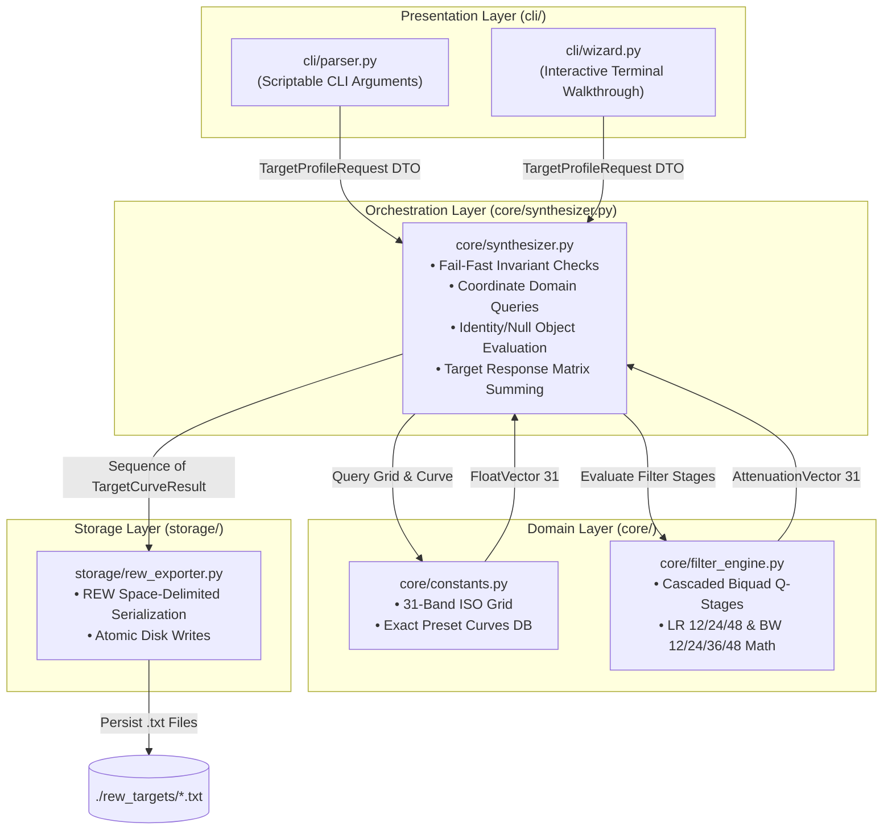

# Implementation Plan: Feature 1 - Curve Selector, Crossover Integrator & REW Exporter

## 1. Goal Description & Scope
The three legacy Excel workbooks in `source_excel/` (`Jazzi'stuningcompanionforREW5.7.xlsm`, `Jazzi's Tuning Companion v8.2.xlsm`, and `JEBTuningcompanionSMAART_REW_ATF_DIRAC V7_10.xlsm`) depend on Windows-only ActiveX controls (`MSForms`) and Visual Basic for Applications (VBA) macros to build speaker target curves and export text files for Room EQ Wizard (REW).

This project implements **Feature 1**: a cross-platform, dependency-free Python CLI tool and core library that:
1. Selects house curves from all included presets (`Whitledge`, `.5 Whitledge`, `JBL`, `Jazzi`, `Jazzi v2`, `EPY`, `ATF`, `Flat`, or custom defined curves) with global dB offset.
2. Configures acoustic crossover points (HP / LP frequencies) and filter topologies (`Linkwitz-Riley 12/24/48 dB/oct`, `Butterworth 12/24/36/48 dB/oct`) for active channels, with primary support for **3-way + front/rear dual subs** (`Sub2` Rear Sub, `Sub1` Front Sub, `Midbass`, `Midrange`, `Tweeter`).
3. Evaluates analytical filter transfer functions and exports clean, REW-ready `.txt` files (`Frequency <space> dB`) using the standard **1/3-octave (31-band)** ISO frequencies.

---

## 2. Supporting Documentation & Governance
This implementation strictly adheres to the specifications and design contracts documented in `docs/`:
- **Domain Specification & Community Usage**: [`docs/jazzi_tuning_companion_spec.md`](./docs/jazzi_tuning_companion_spec.md)
  Master reference for car audio tuning practices, historical curve shapes, driver crossover conventions, and REW EQ / Overlay import workflows.
- **Software Architecture**: [`docs/architecture.md`](./docs/architecture.md)
  Defines the Layered Pipeline Architecture, downward dependency rules, Fail-Fast validation boundary, Null Object/Identity Transformation rule for bypassed filters, and stateless domain operations.
- **Detailed Design**: [`docs/detailed_design.md`](./docs/detailed_design.md)
  Defines exact data models, cascaded biquad $Q$-stage matrices, mathematical formulas, and presentation contracts.

---

## 3. Confirmed Technical Decisions
1. **Interface**: CLI-first approach (providing both an interactive guided terminal walkthrough and non-interactive scriptable arguments).
2. **Channel Setup**: 3-way with front sub and rear sub as the primary first-class layout (`Sub2` Rear Sub, `Sub1` Front Sub, `Midbass`, `Midrange`, `Tweeter`), with full flexibility for traditional 2-way and 3-way setups.
3. **Resolution**: Standard 1/3-octave (31 ISO center frequency points from 20 Hz to 20,000 Hz).
4. **Zero Non-Standard Dependencies**: Built purely with the Python standard library (`math`, `dataclasses`, `enum`, `typing`, `pathlib`, `argparse`).

---

## 4. Architecture & Pipeline Alignment



---

## 5. File & Component Breakdown

### Core Engine & CLI Package (`jazzi_tuning/`)
- **[NEW] `jazzi_tuning/__init__.py`**: Public API surface and package metadata.
- **[NEW] `jazzi_tuning/core/models.py`**:
  - `FilterTopology`: `BYPASS`, `LR12`, `LR24`, `LR48`, `BW12`, `BW24`, `BW36`, `BW48`.
  - `FilterSpec`: Immutable value object with `is_bypassed` property (satisfying the Identity Transformation invariant).
  - `ChannelConfig`: Channel specification with `high_pass` and `low_pass` specifications.
  - `TargetProfileRequest`: High-level execution command DTO.
  - `TargetCurveResult`: Synthesized target curve result with frequency and dB vectors.
- **[NEW] `jazzi_tuning/core/constants.py`**:
  - `ISO_FREQUENCIES_31`: Tuple of the 31 standard frequencies (20 Hz to 20,000 Hz).
  - `PRESET_HOUSE_CURVES`: Exact mathematical baseline tables extracted from the original workbooks:
    - `Whitledge`, `.5 Whitledge`, `JBL`, `Jazzi`, `Jazzi v2`, `EPY`, `ATF`, `Flat`.
- **[NEW] `jazzi_tuning/core/filter_engine.py`**:
  - Analytical biquad transfer functions evaluating attenuation in dB per stage without external numerical libraries.
  - `Q_STAGES` coefficient dictionary matching the original spreadsheets.
- **[NEW] `jazzi_tuning/core/synthesizer.py`**:
  - Validates request invariants (verifies preset existence, asserts $f_{HP} < f_{LP}$ for bandpass drivers).
  - Evaluates channels uniformly via additive identity: $\mathbf{Target}_c = \mathbf{HC} + \mathbf{A}_{HP} + \mathbf{A}_{LP} + \text{offset}$.
  - Applies Excel clamping threshold ($|Target| < 0.1 \implies 0.0\text{ dB}$).
  - Generates standardized REW filenames: `<Curve>_<Tag>_HP<hp>_LP<lp>_REW.txt` and `<Curve>_Overall_REW.txt`.
- **[NEW] `jazzi_tuning/storage/rew_exporter.py`**:
  - Space-delimited text serialization (`Frequency <space> dB`).
  - Atomic write execution to prevent partial file corruption.
- **[NEW] `jazzi_tuning/cli/parser.py`**:
  - Non-interactive command-line argument parser with flags for headless automation.
- **[NEW] `jazzi_tuning/cli/wizard.py`**:
  - Interactive terminal walkthrough prompting for presets, offsets, and crossover frequencies with smart defaults.
- **[NEW] `jazzi_rew.py`**:
  - Top-level executable entry point.

---

## 6. Verification & Automated Test Suite

### Automated Tests (`tests/test_core.py`)
- **[NEW] `tests/__init__.py`** & **`tests/test_core.py`**:
  1. **Preset Accuracy**: Verify all preset values match the reverse-engineered Excel data to within 0.1 dB.
  2. **Filter Mathematical Accuracy**:
     - Verify Butterworth filters measure $-3.01\text{ dB}$ at $f = f_c$.
     - Verify Linkwitz-Riley filters measure $-6.02\text{ dB}$ at $f = f_c$.
     - Verify nominal stopband roll-off slopes ($12, 24, 36, 48\text{ dB/octave}$).
  3. **Identity & Bypassing Invariant**: Verify disabled filters produce $0.0\text{ dB}$ attenuation across all 31 frequencies.
  4. **Synthesizer Validation**: Confirm fail-fast rejection when $f_{HP} \ge f_{LP}$ or when an unknown curve preset is supplied.
  5. **REW Exporter Formatting**: Confirm 2-column space-delimited structure, numeric precision (1 decimal place), and ascending frequency order.

### Execution Command:
```bash
python3 -m unittest discover -s tests
```

### Manual Verification:
1. Run `python3 jazzi_rew.py --list-curves` and `python3 jazzi_rew.py --list-filters`.
2. Generate a 3-way + front/rear dual subs target set (`Sub2`, `Sub1`, `Midbass`, `Midrange`, `Tweeter`) using LR24 slopes into `./rew_targets`.
3. Compare the generated values directly against `source_excel/JEBTuningcompanionSMAART_REW_ATF_DIRAC V7_10.xlsm` and `source_excel/Jazzi's Tuning Companion v8.2.xlsm`.
4. Verify files can be loaded into REW as both House Curves and Measurement Overlays.
