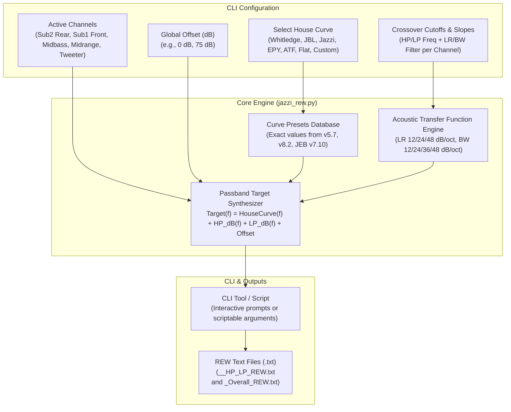

# Implementation Plan: Feature 1 - Curve Selector, Crossover Integrator & REW Exporter

## Goal Description
The 3 Excel workbooks in the workspace (`Jazzi'stuningcompanionforREW5.7.xlsm`, `Jazzi's Tuning Companion v8.2.xlsm`, and `JEBTuningcompanionSMAART_REW_ATF_DIRAC V7_10.xlsm`) rely on Windows-only ActiveX controls (`MSForms`) and Visual Basic for Applications (VBA) macros to configure speaker channels, calculate acoustic filter slopes, combine them with car audio house curves, and export text files for Room EQ Wizard (REW).

Supported by the online usage & capabilities specification in [`docs/jazzi_tuning_companion_spec.md`](./docs/jazzi_tuning_companion_spec.md), we are approaching this conversion **feature by feature**.

---

## User Decisions & Confirmed Requirements
1. **Interface**: CLI-first approach (providing both an interactive guided walkthrough and non-interactive scriptable arguments).
2. **Channel Setup**: 3-way with front sub and rear sub as first-class layout (`Sub2` Rear Sub, `Sub1` Front Sub, `Midbass`, `Midrange`, `Tweeter`), with full flexibility for traditional 2-way and 3-way setups.
3. **Resolution**: Standard 1/3-octave (31 ISO center frequency points from 20 Hz to 20,000 Hz).

---

## Architecture & Data Flow



---

## Proposed Changes

### Core Target Curve & Crossover Engine (Feature 1)

As detailed in [`docs/architecture.md`](./docs/architecture.md) and [`docs/detailed_design.md`](./docs/detailed_design.md), the implementation is structured into a clean modular package (`jazzi_tuning/`) with a top-level executable CLI (`jazzi_rew.py`):

#### [NEW] `jazzi_tuning/` package & `jazzi_rew.py`
A modular, cross-platform Python CLI tool with zero external dependencies (standard library only, using `math` / `cmath`):
- `jazzi_tuning/core/constants.py`: 31-band ISO frequencies & preset house curves database.
- `jazzi_tuning/core/models.py`: DTOs, Enums, ChannelConfig, TargetProfileRequest, TargetCurveResult.
- `jazzi_tuning/core/filter_engine.py`: Analytical transfer functions & cascaded Q-matrix.
- `jazzi_tuning/core/synthesizer.py`: Orchestrator & target response vector synthesis.
- `jazzi_tuning/storage/rew_exporter.py`: REW space-delimited text serialization & atomic file operations.
- `jazzi_tuning/cli/parser.py`: Argparse CLI flags for batch execution.
- `jazzi_tuning/cli/wizard.py`: Guided interactive terminal walkthrough.
- `jazzi_rew.py`: Clean executable entrypoint invoking the CLI.

- **Built-in Presets Database**:
  - `Whitledge`: +24 dB at 20 Hz down to -10 dB at 20 kHz.
  - `.5 Whitledge`: Half-amplitude Whitledge (+12 dB to -5 dB).
  - `JBL`: Andy Wehmeyer / Audiofrog / Harman reference (+9 dB bass shelf, smooth HF slope).
  - `Jazzi` & `Jazzi v2`: Justin Zazzi's hybrid curves.
  - `EPY`: Deep sub-bass emphasis with tailored midrange.
  - `ATF`: Audiotec Fischer (Helix/Brax/Match) curve profile.
  - `Flat`: 0 dB baseline across all 31 frequencies.
  - `Custom`: Custom curve definition from file or command-line values.
  - `Global Offset (dB)`: Shifts all output dB values uniformly (e.g. to align to 75 dB or 85 dB measurement level).
- **Acoustic Filter Transfer Functions**:
  Exact analytical formulas matching the Excel sheets:
  - High-pass:
    $$|H_{HP}(f)| = \prod_{k} \frac{(f / f_c)^2}{\sqrt{(1 - (f / f_c)^2)^2 + (f / (Q_k f_c))^2}}$$
  - Low-pass:
    $$|H_{LP}(f)| = \prod_{k} \frac{1}{|1 - (f / f_c)^2 + j \cdot (f / (Q_k f_c))|}$$
  - Q factors:
    - **LR12**: $Q = 0.5$ (1 stage)
    - **LR24**: $Q_1 = 0.7071, Q_2 = 0.7071$ (2 stages)
    - **LR48**: $Q_1 = 0.5412, Q_2 = 1.3065, Q_3 = 0.5412, Q_4 = 1.3065$ (4 stages)
    - **BW12**: $Q = 0.7071$ (1 stage)
    - **BW24**: $Q_1 = 0.5412, Q_2 = 1.3065$ (2 stages)
    - **BW36**: $Q_1 = 0.5177, Q_2 = 0.7071, Q_3 = 1.9320$ (3 stages)
    - **BW48**: $Q_1 = 0.5098, Q_2 = 0.6013, Q_3 = 0.8999, Q_4 = 2.5628$ (4 stages)
  - Filter Bypassing: Cutoff frequency $\le 0$ or omitted evaluates cleanly to $0\text{ dB}$ (no attenuation).
- **Channel Layouts**:
  - `3way-dual-sub`: `Sub2` (Rear Sub), `Sub1` (Front Sub), `Midbass`, `Midrange`, `Tweeter`.
  - `3way-sub`: `Sub`, `Midbass`, `Midrange`, `Tweeter`.
  - `2way-sub`: `Sub`, `Midbass`, `Tweeter`.
  - Custom channel definitions.
- **REW Exporter**:
  - Exports space-separated `<Frequency> <dB>` formatted lines at standard 31-band 1/3-octave ISO frequencies.
  - Automatically names files using the original macro convention:
    - `<CurveName>_Overall_REW.txt`
    - `<CurveName>_Sub2_HP<hp>_LP<lp>_REW.txt`
    - `<CurveName>_Sub1_HP<hp>_LP<lp>_REW.txt`
    - `<CurveName>_MB_HP<hp>_LP<lp>_REW.txt`
    - `<CurveName>_Mid_HP<hp>_LP<lp>_REW.txt`
    - `<CurveName>_Tw_HP<hp>_LP<lp>_REW.txt`
- **CLI Modes**:
  - **Interactive Mode**: Run `python3 jazzi_rew.py` without arguments (or with `--interactive`) to be guided step-by-step through selecting curve, layout, crossover frequencies, slopes, and output folder.
  - **Scriptable Mode**: Full CLI flags for headless/automated use:
    ```bash
    python3 jazzi_rew.py --curve JBL --layout 3way-dual-sub \
      --sub2-hp 20 --sub2-lp 60 \
      --sub1-hp 25 --sub1-lp 80 \
      --mb-hp 80 --mb-lp 350 \
      --mid-hp 350 --mid-lp 3500 \
      --tw-hp 3500 \
      --slope LR24 --out-dir ./rew_targets
    ```

---

### Automated Tests

#### [NEW] `tests/test_jazzi_rew.py`
Unit test suite verifying:
1. **Preset values**: Ensure all preset house curve values match the values extracted from the original workbooks down to 0.1 dB.
2. **Filter transfer functions**:
   - Verify Butterworth filters hit exactly $-3.01\text{ dB}$ at $f = f_c$.
   - Verify Linkwitz-Riley filters hit exactly $-6.02\text{ dB}$ at $f = f_c$.
   - Verify roll-off asymptotes match nominal slope ($12, 24, 36, 48\text{ dB/octave}$).
3. **Channel target composition**:
   - Check acoustic summing of complementary HP and LP filters.
   - Verify bypass of subsonic Sub HP and ultrasonic Tweeter LP.
   - Verify 3-way + front/rear dual subs channel calculation.
4. **REW export formatting**:
   - Check file names, 2-column structure, numeric precision (1 decimal place), and ascending frequency order.

---

## Verification Plan

### Automated Tests
Execute the test suite using standard Python:
```bash
python3 -m unittest discover -s tests
```

### Manual Verification
1. Run `python3 jazzi_rew.py --list-curves` and `python3 jazzi_rew.py --list-filters`.
2. Generate a 3-way + front/rear subs target set (`Sub2`, `Sub1`, `Midbass`, `Midrange`, `Tweeter`) with LR24 slopes into a test directory.
3. Compare the generated numbers directly against the values in `JEBTuningcompanionSMAART_REW_ATF_DIRAC V7_10.xlsm` and `Jazzi's Tuning Companion v8.2.xlsm`.
4. Validate that the text files follow REW's specification and import smoothly into REW.
